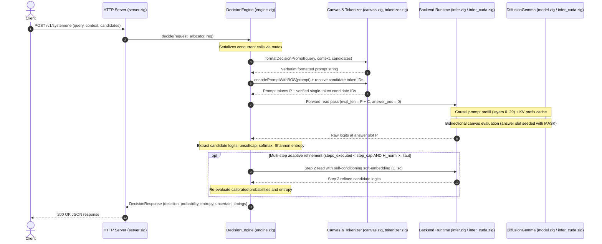

# Zeno — Architecture

## 1. Purpose

Zeno is a research project for a lightweight, Jev-style structured decision runtime built in Zig and based on DiffusionGemma.

Rather than serving as a conversational text generator, the architecture is organized around **structured decision execution** (structured reads) over a seeded token canvas:

```text
Application State + Query Schema
               ↓
Seeded Token Canvas (pinned noisy decision slots)
               ↓
Parallel Forward Read (single-step / capped diffusion)
               ↓
Candidate Logit Extraction & Entropy (calibration to be evaluated)
               ↓
Structured Decision (typed label, boolean, or score)
```

The runtime makes this execution process explicit, reproducible, inspectable, and efficient. The repository provides a complete CPU reference implementation and an accelerated sub-100ms dual-GPU CUDA runtime.

Zeno remains smaller in scope than a general-purpose conversational framework, focusing exclusively on deterministic System One decision execution.

---

## 2. Architectural Goals

Zeno has five primary goals:

1. reproduce the structured-reads and discrete diffusion behavior of DiffusionGemma (reference: vLLM PR #57250);
2. execute reproducible, schema-constrained "System One" decisions and report candidate scores and entropy, with calibration to be evaluated;
3. provide a clean CPU/reference execution path for canvas seeding, forward evaluation, and logit extraction;
4. investigate CUDA and multi-GPU execution, using llama.cpp PR #24423 and a separate experimental community patch as references; cache lifetime, self-conditioning placement, and sharding strategy remain design questions;
5. maintain a small, understandable foundation without unnecessary abstraction layers.

Performance matters for System One decisions, but semantic correctness and model understanding come first. Calibration and performance must be measured.

---

## 3. High-Level Structure & System Tour

The system is organized into the following architectural layers:

```text
┌─────────────────────────────────────────┐
│                 Frontend                │
│    CLI / Jev System One Decision API    │
└────────────────────┬────────────────────┘
                     │
┌────────────────────▼────────────────────┐
│             Decision Engine             │
│  canvas seeding / pinned slots / read   │
└────────────────────┬────────────────────┘
                     │
┌────────────────────▼────────────────────┐
│              Model Runtime              │
│       canvas state / execution step     │
└────────────────────┬────────────────────┘
                     │
┌────────────────────▼────────────────────┐
│               Model Layer               │
│   embeddings / MoE blocks / attention   │
└────────────────────┬────────────────────┘
                     │
┌────────────────────▼────────────────────┐
│                Tensor                   │
│     shape / dtype / layout / storage    │
└────────────────────┬────────────────────┘
                     │
┌────────────────────▼────────────────────┐
│                Backend                  │
│       CPU reference / CUDA / Multi-GPU  │
└─────────────────────────────────────────┘
```

### 3.1 End-to-End Decision Lifecycle (System Tour)

A decision query flows from the client through prompt construction, model evaluation, and entropy-gated candidate selection:



---

## 4. Frontend

The frontend provides the interface for structured decision queries and runtime diagnostics.

Responsibilities include:

* receiving structured query requests (e.g. Jev-compatible `/v1/systemone` format or native Zig API calls);
* parsing query schemas (boolean judgments, multiple-choice classification, ordinal scoring);
* configuring step limits (e.g. single-step read vs capped iterative refinement);
* formatting responses with typed labels, candidate scores, normalized probabilities where appropriate, and Shannon entropy; calibration must be evaluated separately;
* exposing basic runtime diagnostics and performance metrics.

The frontend does not contain model execution semantics.

It should be possible to change the CLI without changing the denoising engine.

---

## 5. Model Runtime

The model runtime manages forward evaluation and state transitions across execution backends:
- **CPU Reference Runtime (`src/infer.zig`)**: Implements `InferenceWorkspace` with multi-threaded layer pooling (`LayerPool`), full sliding-window and global attention, unquantized dequantization tables, and explicit activation buffers. Serves as the mathematical ground truth.
- **CUDA Multi-GPU Runtime (`src/infer_cuda.zig`)**: Implements `CudaWorkspace` and `CudaDeviceWorkspace`, managing dual-GPU pipeline execution across Device 0 and Device 1. Features include prompt KV prefix caching (Phase 7B), device-resident canvas restoration buffers (`canvas_init_emb`, `canvas_raw_ans`), and multi-step CUDA graph capture and replay (`graph0_step2`) eliminating driver dispatch overhead.

The runtime coordinates the forward evaluation sequence:
```text
prompt prefix tokens + canvas template
                 ↓
causal prompt prefill (populate prompt KV cache)
                 ↓
bidirectional canvas forward read (answer slot pinned at MASK)
                 ↓
raw logit extraction at answer slot (P)
                 ↓
[adaptive step 2 required? (H_norm >= tau)]
    ├── yes: inject self-conditioning soft-embedding (E_sc) and replay graph
    └── no: finalize decision
                 ↓
candidate probabilities, entropy, and typed decision
```

---

## 6. Model Layer

The model layer represents the 30-layer Gemma 4 Mixture-of-Experts architecture defined in [`specs/transformer.md`](specs/transformer.md) and mapped from the local GGUF artifact (`diffusiongemma-26B-A4B-it-Q4_K_M.gguf`, cataloged in [`specs/gguf-mapping.md`](specs/gguf-mapping.md)):

```text
GGUF File & Metadata (header, tensor descriptors, chat template)
                   ↓
Model Weights & Mappings (token_embd, 30 transformer layers, output_norm)
                   ↓
Execution Components:
  - Token embedding lookup and unweighted input RMSNorm
  - Attention: GQA with 16 query heads / 4 KV heads (d_head=256), dual-frequency RoPE
  - MoE Feed-Forward: 128 experts (8 active per token) with top-8 routing and GeGLU activation
  - Shared Dense FFN: 2112-dim intermediate projection
  - Post-attention and post-FFN residual normalization
                   ↓
Final Output Norm & Candidate Logit Projection
```

Model semantics are mathematically identical between CPU and CUDA backends, governed by the reference tolerance policy `zeno.tolerance/v2` in [`specs/UNRESOLVED.md`](specs/UNRESOLVED.md).

---

## 7. Tensor Layer

Tensor is a fundamental semantic abstraction.

A tensor is not merely a pointer to memory.

The runtime must be able to reason about:

```text
shape
dtype
layout
storage
device
```

These properties must not be hidden when they affect correctness.

Tensor abstractions should remain lightweight.

Avoid creating a large tensor framework unless Zeno actually requires one.

---

## 8. Backend Layer & Multi-GPU Execution

The backend provides hardware-specialized execution primitives:

- **CPU Backend (`src/infer.zig`)**: Semantic reference implementation executed on host CPU with multi-threaded layer-pool concurrency.
- **CUDA Dual-GPU Pipeline Backend (`src/infer_cuda.zig`)**: Implements Pipeline Layer Splitting (Strategy A), partitioning the 30-layer model across two GPUs (e.g. dual RTX 3060 12GB):
  * **Device 0**: Transformer Layers 0..14 (~7.6 GB VRAM footprint including activation workspace).
  * **Device 1**: Transformer Layers 15..29 + Final Output RMSNorm (~7.6 GB VRAM footprint).
  * **Inter-Device Transfer**: Exactly one boundary transfer per step (transferring hidden state $H_{15}$ of shape $[N \times 2816]$ FP32). Coordinated asynchronously via `cudaMemcpyPeerAsync` and `boundary_event` (`cudaStreamWaitEvent`), or staged through pinned host memory fallback.
  * **Performance**: Achieved the **sub-100ms structured decision milestone** ($C=16$: **99.87 ms** median canvas step 1 latency, **100.55 ms** HTTP round-trip).
- **Open Research (Strategy B)**: Tensor/expert parallelism (distributing the 128 MoE experts across GPUs with intra-layer All-to-All collectives) remains an active research question documented in [`specs/multi-gpu.md`](specs/multi-gpu.md).

---

## 9. Decision Engine & Structured Reads

The decision engine is the conceptual center of Zeno. Rather than generating conversational text token-by-token, Zeno operates over a seeded token canvas and executes **structured reads**:

### 9.1 Structured Reads Mode (System One Decision Primitive)

In structured-reads mode, the engine evaluates decisions in a single deterministic forward pass:
1. **Seed Canvas**: Place input context and assistant prefix (`<|turn>user\n...<|turn>model\nAnswer: `) into the causal prompt region ($0 \dots P-1$). Place `MASK` (`4`) at canvas index 0 and `TURN_CLOSE` (`106`) at canvas index 1.
2. **Forward Read**: Execute causal prompt prefill followed by bidirectional canvas evaluation.
3. **Logit Readout**: Extract logits at canvas index 0 ($P+0$), restricted exclusively to the valid candidate token IDs.
4. **Scoring & Entropy**: Apply single-softcapped unsoftcap transformation (`unsoftcap(logit, 30.0)`), compute softmax candidate probabilities, and evaluate normalized Shannon entropy ($H_{\text{norm}}$).
5. **Calibration**: Apply empirical temperature scaling ($T_{\text{opt}} \approx 1.60$) for well-calibrated confidence estimates, as established in [`specs/calibration-analysis.md`](specs/calibration-analysis.md).

### 9.2 Adaptive Denoising & Multi-Step Refinement

When candidate entropy exceeds the decision threshold ($H_{\text{norm}} \ge \tau$, default $\tau = 0.50$):
- **Self-Conditioning Soft Embedding ($E_{\text{sc}}$)**: Evaluated at native temperature ($T=1.0$), weighted across candidate embeddings, and projected through the self-conditioning MLP.
- **Step 2 Refinement**: Canvas position 0 is updated with $E_{\text{sc}}$ and evaluated through Step 2 using multi-step CUDA graph replay (`graph0_step2`), completing in **203.99 ms** (-55.5% faster than uncached execution).
- **Empirical Impact**: As documented in [`specs/denoising.md`](specs/denoising.md), adaptive 2-step denoising virtually eliminates option-rotation bias (86.00% vs 84.67%, delta only 1.33%) and cuts multi-class Brier score nearly in half (0.3956 -> 0.2448).
- **Scope Boundary**: Open-ended conversational infilling and multi-token text generation remain outside Zeno's System One decision scope.

---

## 10. Compile-Time vs Runtime Boundary

Zeno intentionally separates static structure from runtime state.

### Compile-time information

Potential examples include:

```text
model configuration
static type information
specialized dimensions
dispatch structure
kernel configuration
compile-time validation
```

### Runtime information

Examples include:

```text
weights
input
token canvas
denoising state
activations
sampling state
GPU memory
allocator state
```

The architecture should avoid turning runtime model state into compile-time structure merely for abstraction convenience.

---

## 11. Reference vs Optimized Paths

The project should maintain a distinction between:

```text
semantic reference
        ↓
optimized implementation
```

For example:

```text
CPU reference attention
        ↓
CUDA attention kernel
```

The optimized implementation should be judged against the reference behavior.

This distinction is especially important while the model semantics are still being investigated.

---

## 12. External References

Zeno relies on two key external implementations as behavioral references:

1. **[vLLM PR #57250](https://github.com/vllm-project/vllm/pull/57250)** (`examples/features/structured_diffusion/structured_server.py`):
   - Reference for a prototype **structured-reads mode**, seeded canvas construction, selected answer positions, and a sample interposer providing the Jev-compatible `/v1/systemone` API. The PR notes that this is not a standard vLLM endpoint and that candidate answers must be single tokens.

2. **[llama.cpp PR #24423](https://github.com/ggml-org/llama.cpp/pull/24423)** and the [separate experimental Multi-GPU patch](https://github.com/readwrightexecute/llamacpp-diffusiongemma-multigpu):
   - PR reference for DiffusionGemma GGUF execution (`llama-diffusion-cli`) and non-causal attention. The community patch explores a specific two-GPU setup; its behavior should not be generalized without independent validation.

However:

```text
External reference architecture
              ≠
       Zeno architecture
```

Zeno borrows verified semantics while intentionally avoiding unnecessary historical or framework complexity.

The reference runtimes are oracles for behavior, not templates for internal design.

---

## 13. Data Flow

The structured decision data flow is:

```text
Application State & Typed Query
              ↓
Schema Mapping & Template Construction
              ↓
Seeded Token Canvas (pinned noisy slots)
              ↓
Parallel Model Evaluation (bidirectional attention)
              ↓
Pinned Slot Logit Readout (restricted to candidate tokens)
              ↓
Candidate Normalization & Shannon Entropy (calibration evaluated separately)
              ↓
Decision Output with Candidate Scores and Entropy (calibration to be evaluated)
```

Each transition corresponds to a mechanically verifiable runtime step.

---

## 14. Ownership of Responsibilities

A useful responsibility split is:

```text
Frontend
    owns user interaction, HTTP endpoints, and CLI queries

Decision Engine / Schema Mapper
    owns schema-to-canvas mapping, answer-position selection, logit extraction, and any empirically validated calibration

Runtime
    owns execution state, canvas lifetime, and step control flow

Model
    owns model semantics, MoE routing, and bidirectional attention

Tokenizer
    owns encoding input text to tokens and decoding candidate labels

Tensor
    owns tensor representation and quantized layout

Backend
    owns execution mechanics (CPU, CUDA, and Multi-GPU tensor splitting)

Allocator / Memory
    owns lifetime mechanics and step arena allocations
```

These responsibilities may be implemented with fewer concrete modules.

Conceptual separation is more important than file-count separation.

---

## 15. Architectural Constraints

The following constraints are intentional:

* Do not build a general inference framework.
* Do not optimize before semantic correctness is established.
* Do not hide memory ownership.
* Do not hide tensor layout when it matters.
* Do not duplicate model semantics across backends.
* Do not introduce abstractions solely to support hypothetical future models.
* Do not allow GPU kernels to silently redefine the model.
* Keep reference implementations available while semantics are under investigation.

---

## 16. Evolution Strategy

Zeno should evolve approximately in this direction:

```text
Understand
    ↓
Reference implementation
    ↓
Minimal CPU runtime
    ↓
End-to-end denoising
    ↓
CUDA execution
    ↓
Profiling
    ↓
Selective optimization
```

Optimization may later change internal structure.

Model semantics should remain the stable center.
