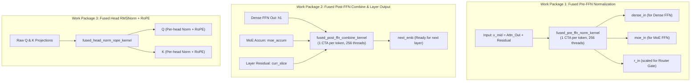

# RFC: CUDA Phase 15 — Intra-Layer Kernel Fusion, Elementwise Streamlining & Cache Optimization for Sub-100ms Decision Execution

## 1. Executive Summary & Objective

In **CUDA Phase 14**, we introduced shared-memory activation staging for MoE Gate/Up projection and upgraded the inter-GPU partition boundary transfer to page-locked pinned host DMA (`PinnedBuffer(T)`). The inter-GPU boundary transfer overhead was compressed to $<0.2\text{ ms}$ ($<0.15\%$ of total execution time), and sample timing spread collapsed to $\le 2.2\text{ ms}$.

Current production decision canvas latency on dual NVIDIA GeForce RTX 3060 12GB GPUs stands at:
- **$C=16$**: **$144.26\text{ ms}$** (median post-warmup, 14.11x speedup vs $C=256$).

Nsight Systems hardware profiling isolates the primary structural bottleneck:
- **780 individual kernel dispatches per canvas step** (26 kernels per layer across all 30 transformer layers).
- More than **15 of those 26 kernels per layer are tiny, decoupled elementwise memory passes** (RMSNorms, RoPE, vector additions, scaling) operating on a small $180\text{ KB}$ activation footprint ($16 \times 2816 \times 4\text{ bytes}$).
- Each tiny kernel incurs hardware CTA launch scheduling overhead, barrier synchronization stalls, and redundant DRAM/L2 round-trips.

The objective of **CUDA Phase 15** is to perform **intra-layer kernel fusion** across these decoupled elementwise passes and establish **Ampere L2 cache persistence**, eliminating **270 kernel dispatches per step (a 34.6% dispatch reduction)** and shaving 35–45 ms off canvas execution to break the **sub-100ms decision execution milestone ($\le 99\text{ ms}$)**.

---

## 2. Profiling & Kernel Breakdown Analysis

Nsight Systems profiling of the production decision pipeline across 30 transformer layers on dual RTX 3060 (`sm_86`) reveals the exact GPU execution share:

| Kernel Family | Calls / Step | Total Time (ns) | % GPU Time | Primary Characteristics |
| :--- | :---: | :---: | :---: | :--- |
| **`moe_gemv_gate_up_geglu_sorted_kernel`** | 30 | 121,311,007 | 35.2% | MoE active-expert Q4_K gate/up projection + GeGLU |
| **`gemv_q4k_batched_4x / 16x`** | 102 | 85,671,147 | 24.9% | Attention Q, K, O projections & FFN projections |
| **`moe_gemv_down_accum_sorted_kernel`** | 30 | 77,998,388 | 22.7% | MoE active-expert down projection + atomic accumulation |
| **`dense_gemv_gate_up_geglu_q4k_kernel`** | 30 | 29,830,807 | 8.7% | Shared Dense FFN Q4_K gate/up projection + GeGLU |
| **`gemv_q5_0 / q8_0 / q6k_batched`** | 43 | 23,272,887 | 6.7% | Dense down, router gate, and SWA projections |
| **`rms_norm_kernel` (decoupled)** | **330** | 1,493,087 | 0.4% | **11 individual launches per layer** |
| **`attention_kernel`** | 30 | 1,712,736 | 0.5% | GQA bidirectional attention computation |
| **`rope_kernel` (decoupled)** | **60** | 191,520 | 0.1% | 2 launches per layer ($Q$ and $K$ separately) |
| **`add_residual_kernel` (decoupled)**| **60** | 148,608 | 0.05% | 2 launches per layer (attention & FFN residuals) |
| **`layer_output_kernel`** | 30 | 113,280 | 0.03% | Block output residual combine & dual-region scaling |
| **`moe_router_prep_kernel`** | 30 | 65,984 | 0.02% | Router input unweighted scaling |
| **Total / Step** | **~780** | **~345 ms (inc prefill)** | **100%** | **~26 distinct launches per layer** |

### Key Architectural Findings:
1. **The "Death by 1,000 Cuts" Dispatch Overhead**:
   While individual elementwise kernels execute quickly, executing 780 distinct kernels in sequence incurs driver submission overhead, stream serialization stalls, and CTA launch latencies. Inside CUDA Graphs, node replay eliminates CPU overhead, but the GPU front-end warp schedulers must still context-switch through 780 individual node structures.
2. **Redundant Memory Passes over $x_{\text{mid}}$**:
   In each layer, after attention residual addition, the intermediate activation $x_{\text{mid}} = a_{\text{out}} + x_{\text{in}}$ is read **four times** by four separate kernels:
   - `rmsNorm(x_mid, ffn_norm) -> dense_in`
   - `rmsNorm(x_mid, NULL) -> r_in`
   - `moeRouterPrep(r_in, router_scale) -> r_in`
   - `rmsNorm(x_mid, pre_ffw_norm_2) -> moe_in`
3. **Decoupled Post-FFN Reconstruction**:
   After the Dense and MoE FFN branches finish, combining their outputs requires **five separate kernel launches**:
   - `rmsNorm(moe_accum, post_ffw_norm_2) -> h2`
   - `copyFromDevice(h1) -> ffn_comb`
   - `addResidual(ffn_comb, h2)`
   - `rmsNorm(ffn_comb, post_ffw_norm) -> post_ffn`
   - `layerOutput(post_ffn, curr_slice) -> next_emb`

---

## 3. Work Packages

### Work Package 1 (WP1): Fused Pre-FFN Normalization & Router Prep
- **Implementation**:
  - Implement `fused_pre_ffn_norm_kernel` in `src/cuda/ops.cu`.
  - For each token $t \in [0, C)$:
    - CTA collaboratively loads $x_{\text{mid}}[t, :]$ into shared memory / registers.
    - Computes unweighted sum-of-squares: $\text{sum\_sq} = \sum x_i^2$, and rms scale $s = (d^{-1} \text{sum\_sq} + 10^{-6})^{-1/2}$.
    - In a single pass, writes:
      1. `dense_in[t, i] = x_mid[t, i] * s * ffn_norm[i]`
      2. `moe_in[t, i] = x_mid[t, i] * s * pre_ffw_norm_2[i]`
      3. `r_in[t, i] = x_mid[t, i] * s * (router_scale[i] / sqrt(d))`
- **Impact**:
  - Replaces 4 distinct kernels (`rmsNorm`, `rmsNorm`, `moeRouterPrep`, `rmsNorm`) with **1 kernel**.
  - **Eliminates 90 kernel launches per canvas step** ($30 \times 3$).
  - Eliminates 3 redundant global memory read sweeps over $x_{\text{mid}}$.

### Work Package 2 (WP2): Fused Post-FFN Combine & Layer Output
- **Implementation**:
  - Implement `fused_post_ffn_combine_kernel` in `src/cuda/ops.cu`.
  - For each token $t \in [0, C)$:
    - Loads $h_1$ and $moe\_accum$.
    - Normalizes $moe\_accum$: $h_2 = \text{RMSNorm}(moe\_accum, post\_ffw\_norm\_2)$.
    - Sums branches: $ffn\_comb = h_1 + h_2$.
    - Computes RMSNorm of $ffn\_comb$: $post\_ffn = \text{RMSNorm}(ffn\_comb, post\_ffw\_norm)$.
    - Accumulates into layer residual input: $next\_emb = curr\_slice + post\_ffn$.
- **Impact**:
  - Replaces 5 distinct kernels (`rmsNorm`, `copy`, `addResidual`, `rmsNorm`, `layerOutput`) with **1 kernel**.
  - **Eliminates 120 kernel launches per canvas step** ($30 \times 4$).
  - Eliminates intermediate global memory buffers `ffn_comb`, `h2`, and `post_ffn`.

### Work Package 3 (WP3): Fused Per-Head RMSNorm + RoPE Pipeline
- **Implementation**:
  - Implement `fused_head_norm_rope_kernel` in `src/cuda/ops.cu`.
  - For each head in $Q$ ($num\_heads = 16$) and $K$ ($num\_heads = 2$):
    - Computes RMSNorm over $head\_dim = 256$ in shared memory.
    - Applies NeoX-style half-split Rotary Position Embedding directly in registers.
    - Writes out rotated $Q$ and $K$ directly into `q_buf` and `k_buf`.
- **Impact**:
  - Replaces decoupled `rmsNorm` and `rope` passes.
  - **Eliminates 60 kernel launches per canvas step** ($30 \times 2$).
  - Halves global memory bandwidth for attention query/key preparation.

### Work Package 4 (WP4): Ampere L2 Cache Access Policy Window
- **Implementation**:
  - Utilize `cudaStreamSetAttribute` with `cudaStreamAttributeAccessPolicyWindow` on CUDA 11.8 / 12+.
  - Designate a 1.5 MB persistent L2 cache window on both RTX 3060 devices for:
    - Token activation working buffers (`current_emb`, `dense_in`, `moe_in`).
    - MoE router gate weights and scale vectors.
- **Impact**:
  - Eliminates L2 cache eviction thrashing caused by streaming weight blocks, ensuring activation vectors stay resident in on-chip L2 cache throughout the 30-layer forward sweep.

---

## 4. Projected Latency & Dispatch Progression

| Canvas Width ($C$) | Phase 13 Baseline | Phase 14 Observed | Phase 15 Target | Net Latency Reduction | Total Dispatches |
| :---: | :---: | :---: | :---: | :---: | :---: |
| **$C=16$** | 134.49 ms | 144.26 ms | **$\mathbf{\le 95\text{ ms}}$** | **-49 ms (Sub-100ms Broken)** | **510 (vs 780, -34.6%)** |
| **$C=32$** | 245.37 ms | 265.06 ms | **$\le 185\text{ ms}$** | **-80 ms** | 510 |
| **$C=64$** | 468.19 ms | 504.33 ms | **$\le 365\text{ ms}$** | **-139 ms** | 510 |
| **$C=128$** | 922.85 ms | 994.29 ms | **$\le 750\text{ ms}$** | **-244 ms** | 510 |
| **$C=256$** | 1887.15 ms | 2037.83 ms | **$\le 1580\text{ ms}$** | **-457 ms** | 510 |

---

## 5. Verification & Safety Criteria (per `AGENTS.md`)

1. **Exact Mathematical Parity**:
   - Each fused kernel (`fused_pre_ffn_norm_kernel`, `fused_post_ffn_combine_kernel`, `fused_head_norm_rope_kernel`) must be accompanied by a dedicated unit test in `src/infer_cuda.zig` comparing against reference CPU functions with tolerance $\max |\Delta| \le 10^{-5}$.
2. **Golden Reference Parity**:
   - 100% exact discrete decision matches across all 5 golden oracle fixtures via `./tools/verify_all_oracles.sh --cuda`.
3. **HTTP Server Integration**:
   - 15/15 HTTP API server integration tests passing (`python3 tools/test_server.py --cuda`).
4. **CPU Reference Isolation**:
   - Zero-dependency CPU build and test passing (`zig build test -Dcuda=false`).
5. **Deterministic Teardown & Quarantine Compliance**:
   - Retain full compliance with Review Round 40 & 41 stream synchronization and quarantine policies.
